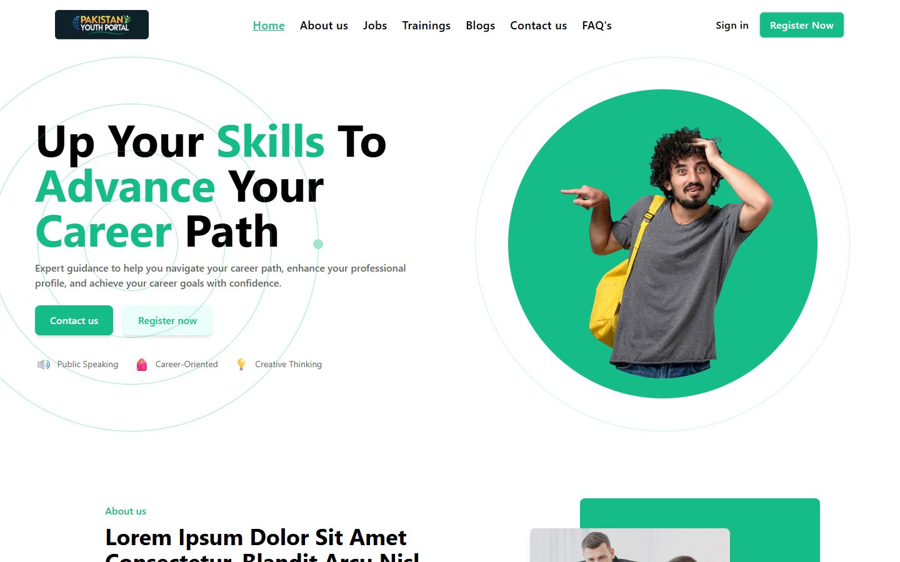
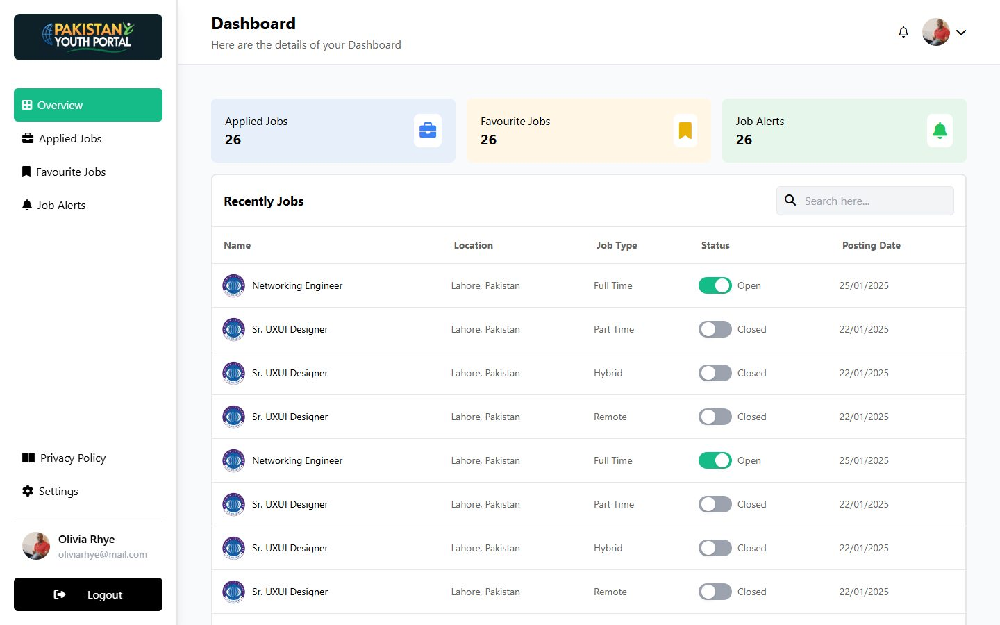
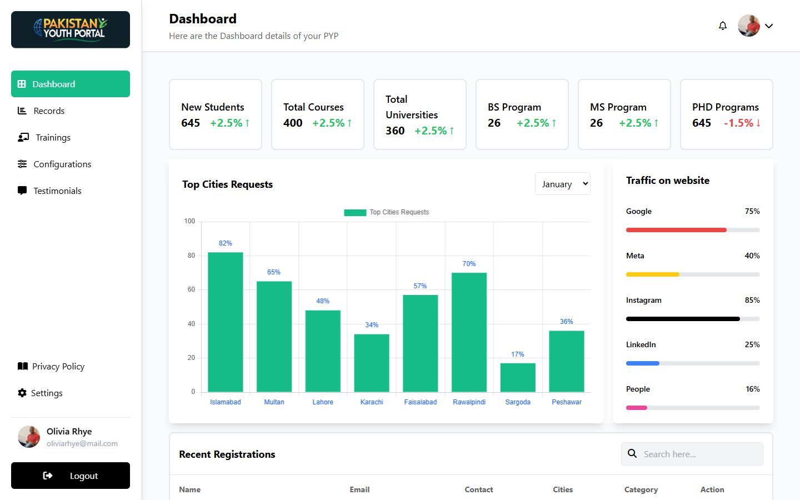

# Pakistan Youth Portal (frontend)

**An Angular frontend for a youth career portal: young people browse jobs, trainings and blogs and manage their applications, while admins run the content from a dashboard with charts.**

[](https://github.com/Umair-Habibx123/pakistan-youth-portal/actions/workflows/ci.yml)
[](https://angular.dev)
[](https://tailwindcss.com)

> **About this repository.** I built this frontend during my Angular internship at
> [AIMS Soft](https://github.com/aims-soft). This repo is **my last version** from that
> internship (March to May 2025). AIMS Soft has continued developing the product in its own
> repositories and runs the official site at **[pakistanyouthportal.com](https://pakistanyouthportal.com/#/)**.
>
> This snapshot is **frontend only**: all content is sample data inside the components, and
> sign-in, registration, applications and admin edits are UI flows that don't save anything.



## What I built

**Public site**
- Home page with banner, about section, success stories, team and "why this portal" sections
- **Jobs** with search by title, category and location; **Trainings**; **Blogs**
- About us, Contact us and FAQ pages
- Sign in, register (with form validation), forgot password and verification-code screens

**User dashboard:** an overview with counters, plus applied jobs, favourite jobs and job alerts

**Admin dashboard**
- Statistics cards and Chart.js charts, such as requests by city and traffic sources
- A records table of registrations
- Management screens for trainings, testimonials, and site configuration (slider, about us)

| Jobs | User dashboard |
| --- | --- |
|  |  |



## Run it locally

You need **Node.js 18** (the newest version Angular 16 officially supports; newer versions also built fine in testing).

```bash
git clone https://github.com/Umair-Habibx123/pakistan-youth-portal.git
cd pakistan-youth-portal
npm install
npm start          # http://localhost:4200
```

There are no sign-in guards in this version, so you can open **/user-dashboard** and **/admin-dashboard** directly.

| Command | What it does |
|---|---|
| `npm start` | Starts the dev server at http://localhost:4200 |
| `npm run build` | Builds the production site into `dist/pakistan-youth-portal/` |

## How it's built

| Part | What it uses |
|---|---|
| Framework | Angular 16 (NgModules), RxJS, Angular Router |
| Styling | Tailwind CSS, Font Awesome icons |
| Charts | Chart.js with `chartjs-plugin-datalabels` |

```
libs/pages/        public pages: home, jobs, trainings, blogs, about, contact, FAQ, login, register, navbar, footer
libs/dashboard/    user-dashboard/, admin-dashboard/, and shared/ (settings, privacy policy)
libs/services/     shared services
src/assets/        images
erd.txt            planned database design (dbdiagram.io syntax)
```

The planned database is described in `erd.txt` and `Pakistan Youth Portal.sql`; this snapshot doesn't connect to it.

## Credits

Built by [Umair Habib](https://github.com/Umair-Habibx123) during an internship at [AIMS Soft](https://github.com/aims-soft). The official, maintained version is at [pakistanyouthportal.com](https://pakistanyouthportal.com/#/).
